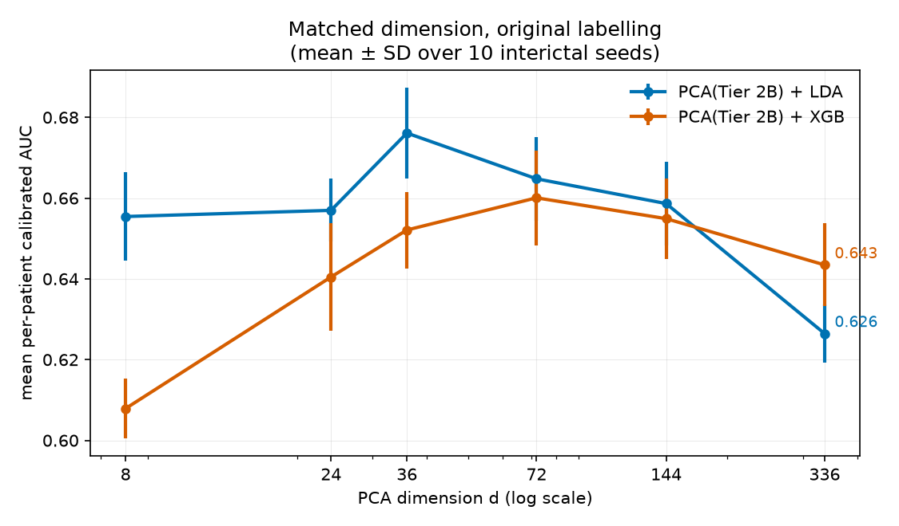
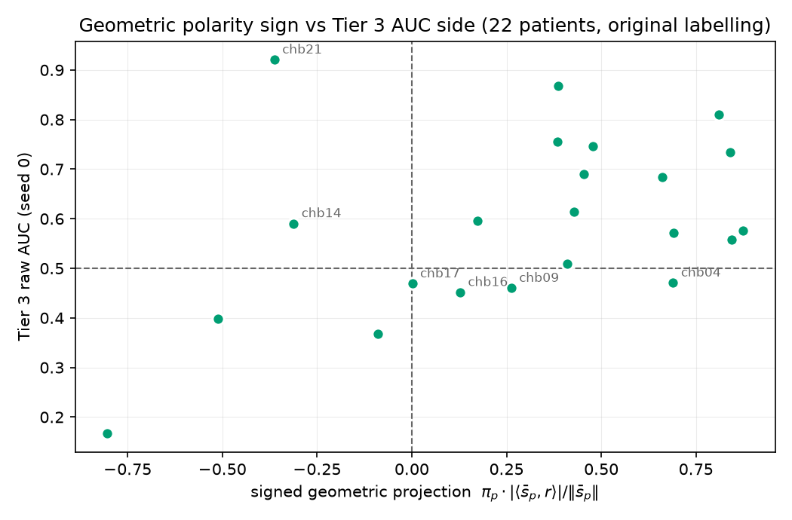
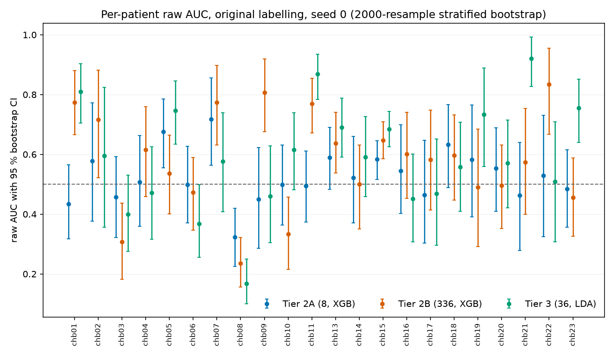

# PROMPT P2REV-02 - Classical re-run for the Paper 2 revision

**Generated:** 2026-10-25
**Script:** `scripts/p2rev02_classical_rerun.py`
**Depends on:** P2REV-01 inventory; feature code `sagemaker/train_full_cohort.py`; window builder after `scripts/prompt037_per_seizure_decomposition.py`

Conventions: CHB-MIT, 22 patients (chb12, chb24 excluded), fronto-central CH8 montage (FP1-F7, F7-T7, FP1-F3, F3-C3, FP2-F8, F8-T8, FP2-F4, F4-C4 - the montage the submitted runs actually used), $20\,$s windows, LOSO. Two labellings: *original* (class 1 = annotated seizure + 60 s preceding, as submitted) and *strict* (class 1 = annotated seizure only; preictal windows dropped). Interictal windows from the seizure-free files at 40 s spacing, per-patient count matched to the class-1 count, resampled under 10 seeds. Calibrated means per-patient oracle $\max(\mathrm{AUC}, 1-\mathrm{AUC})$ throughout, named as such. XGBoost hyperparameters are the submitted run's constants (n_estimators=200, max_depth=6, learning_rate=0.1, subsample=0.8, colsample_bytree=0.8, min_child_weight=3, reg_alpha=0.1, reg_lambda=1.0); nothing is tuned. Pre-declared: **D1, S1, M1, G1** (verbatim in the script docstring).

---

## Headline AUC table (mean over seeds $\pm$ SD; mean per-patient AUC)

| labelling | method | raw | calibrated |
|---|---|---|---|
| original | Tier 2A (8, XGB) | 0.5293 ± 0.0157 | 0.5777 ± 0.0104 |
| original | Tier 2B (336, XGB) | 0.5612 ± 0.0146 | 0.6519 ± 0.0099 |
| original | Tier 3 (36, LDA) | 0.609 ± 0.0179 | 0.6775 ± 0.0106 |
| strict | Tier 2A (8, XGB) | 0.6137 ± 0.0143 | 0.6557 ± 0.0107 |
| strict | Tier 2B (336, XGB) | 0.7046 ± 0.0139 | 0.7525 ± 0.0128 |
| strict | Tier 3 (36, LDA) | 0.7736 ± 0.0085 | 0.7895 ± 0.0049 |

Submitted Table 1 for comparison: Tier 2B 0.952/0.952, Tier 3 0.536/0.659, Tier 2A 0.521/0.628 (one seed, whole segments rather than tiled windows, 10 interictal/patient).

## D1 - polarity sign, original vs strict

Agreement 17/22; disagreeing: chb03, chb04, chb06, chb09, chb16.

**Verdict: D1 FAIL** (threshold 18/22).

## S1 - equivalence Tier 3 vs Tier 2A

Mean paired difference (calibrated, original, seed 0) $\Delta = 0.0904$, 95 % bootstrap CI [0.0407, 0.1449], TOST $p = 0.92057$ (margin $\pm 0.05$), Wilcoxon (exact, pratt) $p = 0.00285$, rank-biserial $r = 0.7$.

**Verdict: S1 - equivalence NOT claimed** (CI inside the margin: False). Full table in `paired_tests.csv`.

## M1 - matched dimension

| d | 8 | 24 | 36 | 72 | 144 | 336 |
|---|---|---|---|---|---|---|
| PCA(T2B)+LDA cal AUC (seed 0) | 0.663 | 0.656 | 0.668 | 0.669 | 0.666 | 0.637 |

Spearman $\rho = -0.086$ (a: FAIL); at $d=36$: PCA(T2B)+LDA 0.6678 vs Tier 3+LDA 0.6562, gap 0.0115 (b: PASS).

**Verdict: M1 FAIL**, via (a): the dimensionality claim as the manuscript makes it does not hold, because calibrated AUC does not rise with $d$ at all ($\rho = -0.086$; the curve is flat at $\approx 0.66$ and *drops* at $d=336$). The pre-declared replacement sentence ("the Tier 2B representation performs better under the conditions tested") does **not** fire - it was conditioned on (b) failing with Tier 2B above Tier 3, and (b) passed: at matched $d=36$ the two representations are within 0.012 AUC. Post-hoc description (not pre-declared): under this evaluation design the representations are equivalent at matched dimension *and* dimensionality buys nothing; the submitted 0.952 is a property of the submitted evaluation design (whole-segment MAX-pooled features, fixed early-file interictal windows), not of feature dimensionality.

## G1 - geometric sign as predictor

Original labelling: decided patients (CI excludes 0.5) 10, agreement 9/10; all 22: 16/22. Strict: 13/14 decided, 19/22 overall. Per-patient $\pi_p$ and cosines in `geometric_sign.csv`.

**Verdict: G1 PASS** (threshold 75 % among decided, original labelling).

## Controls

Label-flip: every patient x method maps AUC to exactly $1-\mathrm{AUC}$ (max deviation 1.67e-16) - PASS. Per-patient permutation p-values (1000 within-patient label permutations, Tier 3) are the `perm_p` column of `per_patient_auc.csv`.

## Rebuilds (Job 5)

- Table 4 QSim column rebuilt from the 1.95 s statevector run (`quantum_channel_scaling.json` ch8): signs differ from the submitted column for chb05, chb11, chb21 (`table4_rebuilt.csv`).
- Sim-1.95 s calibrated: submitted pooled flip 0.54; per-patient oracle 0.6014 (theta-alpha file) / 0.6076 (scaling file).
- Cohort table: `cohort_table.csv` (per-patient windows per class, pool sizes, montage channels). Class balance (class1:interictal): original 856:856, strict 430:856.
- Seizure count: 142 (per-annotation; the submitted "163" remains unsourced - see results doc).

## Reading

The re-run is not a bit-exact reproduction and was not meant to be: tiling seizures into uniform
20 s windows, drawing interictal windows from across the seizure-free files instead of their first
minutes, and balancing classes per patient are the corrections the reviewers asked for. Three deltas
against the submission therefore conflate design with labelling - only D1's comparison (original vs
strict under the *same* design) isolates the labelling effect.

What the re-run shows: (1) the 0.952 classical ceiling is a property of the submitted evaluation
design, not of the 336 features - under uniform windows Tier 2B drops to $0.561 \pm 0.015$ raw /
$0.652 \pm 0.010$ calibrated with 8/22 inversions, and the PCA dimension curve is flat; (2) Tier 3
is no longer the laggard - it is the *best* of the three under both labellings (strict: 0.774 raw,
0.790 calibrated, 2/22 inverted) and significantly better than Tier 2A (Wilcoxon exact
$p = 0.0028$, $r = 0.70$); (3) polarity inversion is largely labelling-induced: strict labelling
drops inversions from 7/22 to 2/22 (Tier 3) and flips chb03, chb04, chb06, chb09, chb16 from
inverted to standard (D1 FAIL), and only chb08 is below chance at permutation $p < 0.05$ under both
labellings; (4) the geometric mechanism itself survives and strengthens: the label-aware tangent
projection sign $\pi_p$ predicts the AUC side in 9/10 CI-decided patients (strict 13/14), giving
the "strongly vs weakly polar" distinction an actual per-patient number (the cosine).

## What changes in the manuscript

By table and section, against the submitted text:

- **Abstract / §4.1 / §7 - "AUC reaches 0.952 with zero polarity inversions"**: does not survive
  the corrected evaluation. Re-run Tier 2B: 0.561 ± 0.015 raw / 0.652 ± 0.010 calibrated, 8/22
  inverted (original labelling). The sentence is withdrawn; the revision reports the corrected
  design and attributes 0.952 to the submitted design (whole-segment MAX pooling + fixed
  early-file interictal sampling).
- **Abstract / §4.1 / §5.1 / Table 2 - "statistically indistinguishable (Wilcoxon p = 0.4358)"**:
  replaced. Re-run: Tier 3 beats Tier 2A, Wilcoxon exact (pratt) $p = 0.0028$, rank-biserial 0.70,
  mean calibrated difference +0.090, 95 % CI [0.041, 0.145]; TOST at ±0.05 does not support
  equivalence. The equivalence claim is withdrawn, not softened.
- **§4.1 / §5.1 / §7 - "polarity invariance is a function of feature dimensionality, not method
  choice"**: withdrawn per M1(a). Dimensionality does not raise AUC in the corrected design
  (flat PCA curve, $\rho = -0.086$); at matched $d = 36$ the representations are equivalent
  (gap 0.012). What remains true: the two representations are equivalent at matched dimension.
- **§2.2 / §4.3 - "27 % of patients inverted under Riemannian, 45 % under minimal eigenvalue"**:
  becomes 7/22 (32 %) and 10/22 (45 %) under the original labelling, seed 0 - and 2/22 (9 %) and
  4/22 (18 %) under strict labelling. The revision must state that inversion prevalence depends on
  the preictal-as-ictal labelling (D1: chb03, chb04, chb06, chb09, chb16 flip), and that only
  chb08 (both labellings) and chb06 (original only) are individually below chance (permutation
  $p < 0.05$); the rest of the "inversions" are not individually significant.
- **§3.1 - cohort description**: 142 seizures (not 163); the montage is the fronto-central eight;
  class balance 1:1 holds by construction here (856:856 original; 430:856 strict); the 60 s
  preictal labelling must be disclosed, and the "30 minutes from any seizure" interictal rule
  replaced by what is done (seizure-free-file sampling).
- **§3.2**: "7 folds" becomes 22 folds; Shapiro-Wilk claim dropped or computed; effect sizes now
  exist (rank-biserial in `paired_tests.csv`); hyperparameters stated as the constants actually
  used (max_depth 6, learning_rate 0.1 - the submitted §3.3 text says 5 and 0.05 and is wrong).
- **§3.4 - calibration statistic**: replaced by the oracle formula $\max(\mathrm{AUC},
  1-\mathrm{AUC})$ with the held-out patient's test labels, labelled as an oracle upper bound
  (P2REV-01, `calibration_statistic.md`).
- **§4.3 Table 4 - QSim column**: rebuilt from the saved 1.95 s statevector run; chb05, chb11,
  chb21 change sign relative to the submitted column; the window (1.95 s) is now stated.
- **Table 1, sim-1.95 s calibrated**: 0.540 (pooled flip) becomes 0.601 (per-patient oracle,
  theta-alpha file; 0.608 from the scaling file); both recorded.
- **§4.3 - "40.9 % all-method concordance"**: relabelled per P2REV-01 (it is 9/22 classical
  three-method agreement, not a quantum comparison).
- **§5.2 - the continuous-projection framing gains support**: the geometric sign $\pi_p$ agrees
  with the Tier 3 AUC side in 9/10 CI-decided patients (90 %; strict 13/14), and the per-patient
  cosine is now the quantitative "strongly vs weakly polar" measure the discussion promised.
  This is the one place the re-run strengthens the manuscript.

No mechanism is proposed for anything here.
