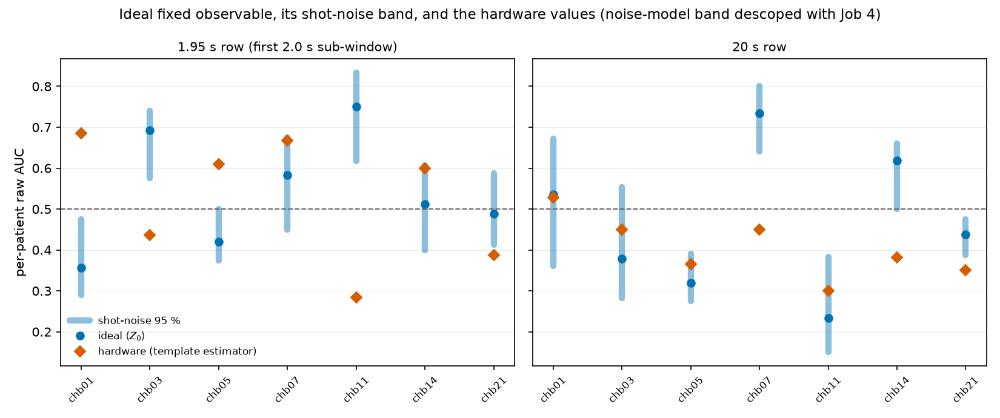

# PROMPT P2REV-03 - The quantum rows: classical equivalent, shot distributions, sign table

**Generated:** 2026-10-31
**Script:** `scripts/p2rev03_quantum_gap.py` (jobs 0-1 run 2026-10-25; jobs 2, 3, 5, 6 resumed
2026-10-31 under the revision of scope)
**Depends on:** P2REV-01 inventory; P2REV-02 `geometric_sign.csv`, `per_patient_auc.csv`;
`QA1/multichannel_circuit.py`; `docs/AGATE_OBSERVABLE_NOTES.md`

Conventions: CHB-MIT, fronto-central CH8, the `train_chbmit` 30 s segment sets the quantum runs
actually used (Job 0, `run_inventory.md`), original labelling unless stated; "the fixed
observable" is the ancilla $\langle Z_0\rangle$ of the A-Gate circuit as section 3.5 defines it,
computed classically by `qdnu/agate_observable.py` (numpy only, no qiskit import). Calibration
is never applied here; all AUCs are raw. **Scope:** Jobs 2, 3, 5, 6; Job 4 / H2 (FakeTorino)
descoped under the 2026-10-31 revision ("H2 then adds nothing"). Pre-declared blocks in force:
**H1, Q1, G2**. Expectation block (Jim, 2026-10-25): "nothing is correct and it's all noise" -
H1 passes, Q1 fails, G2 at chance; anything stronger than chance in Q1 or G2 is a surprise.

---

## What Job 0/1 established (2026-10-25, unchanged)

No submitted quantum row measures $\langle Z_0\rangle$: all four are dual-template fidelity
classifiers with per-fold trained templates. The faithful pipeline reproduces the sim 20 s row
exactly (max dev 0.0) and the sim 1.95 s row to its file's 4-decimal rounding (5e-05); the
"1.95 s" window is 2.0 s in the code; the sim-vs-hardware 1.95 s comparison also differs in
estimator. Those findings stand under this resume and drive the caveat on H1.

## Job 2 - the classical implementation (R2 section 1.9)

`qdnu/agate_observable.py` evaluates $\langle Z_0\rangle$ by direct numpy tensor simulation of
the 17-qubit circuit and $\Pi_b^{\text{coupled}}$ by its exact closed form
$\overline{\sin 2a_k - \sin 2c_k}$ (identity verified to 9.1e-14).

**Verification:** max $|\text{qiskit} - \text{numpy}|$ over all 7 560 sub-windows of the 1.95 s
row: **2.5e-14**; over the 144 windows of the 20 s row: **8.9e-15**. Requirement < 1e-10:
**met**. The circuit is a fixed trigonometric function of the 24 inputs; R2 section 1.9 can be
answered by module path.

**Dead zones (the notes' section 5(2) histogram):** on the 1.95 s sub-windows, **100 %** of
windows have some channel with $a$ or $c > \pi/4$ (every patient; the PLV normalisation maps
amplitudes into $[0.05, 0.95]$, and 0.95 > 0.785 is routinely hit), and **96-99 %** are in a
phase dead zone ($|\sin b|$ or $|\cos b| < 0.3$ on some channel). The 20 s row is the same. The
balance observable's validity conditions essentially never hold on this dataset
(`classical_check.json`).

**The 22-patient re-evaluation** (`ideal_auc_22.csv`, P2REV-02 windows, first 2.0 s per window,
both labellings, zero-shot - the quantum counterpart of P2REV-02's D1): mean per-patient AUC
**0.526** (original) / **0.556** (strict); the 95 % bootstrap CI excludes 0.5 for **one**
patient (chb17, original; chb16 + chb17 strict); permutation finds **one** patient below chance
(chb08, original) and none under strict. The fixed observable carries essentially no
cross-patient signal under either labelling.

## Job 3 - H1, finite-shot distribution

Binomial(1024) resampling of the ideal $\langle Z_0\rangle$, 200 seeds
(`shot_distribution.csv`). Hardware per-patient values inside the 95 % band: **2/7** (1.95 s
row), **4/7** (20 s row). Overall (mean of patients): 1.95 s hardware 0.5241 sits at the 20th
percentile, **inside** [0.507, 0.573]; 20 s hardware 0.4035 at the 0th percentile, **outside**
[0.435, 0.507].

**Verdict: H1 FAIL** (2/7 < 5/7). The per-patient hardware numbers are not shot noise around
the ideal fixed observable - but the Job 0 caveat is the operative explanation: the hardware
AUCs were produced by the template-Hellinger estimator, a different statistic, so there was no
reason for them to sample the $\langle Z_0\rangle$ band in the first place (chb01, chb03 and
chb11 sit near mirror image across 0.5 from their ideal bands). The pre-declared escalation
("Job 4 is where the explanation has to come from") is cut off by the descoping of H2; what can
be said without it is that the aggregate 1.95 s number is consistent with shot noise while the
per-patient numbers are not, and that the estimator mismatch suffices to produce exactly that
pattern. No mechanism is proposed.

## Job 5 - Q1, is the sub-chance readout significant?

`permutation_7.csv`: under the original labelling, **zero** of the 7 hardware-subset patients
are below chance in the ideal simulation at $p < 0.05$ (strict: also zero). Tier 3's
below-chance set from P2REV-02 is {chb06, chb08}. The hardware 20 s row's own scores give no
patient below chance at $p<0.05$ either; the hardware 1.95 s row has no per-segment scores and
no interval is fabricated.

**Verdict: Q1 FAIL** (0 of the required ≥ 3). As pre-declared, the section-5.2 sentence
"per-patient AUC below 0.50 directly indicates manifold inversion" is **replaced** by: the
fixed-basis observable's sign is reported per patient as an observation, with its interval.
This matches the expectation block exactly.

## Job 6 - G2, the sign table

`sign_table.csv`, 7 patients, pairwise agreement (original labelling):

| pair | agree |
|---|---|
| $\pi_p$ vs Tier 3 | 5/7 |
| $\pi_p$ vs hardware 1.95 s | 5/7 |
| $\pi_p$ vs **ideal sim** $\langle Z_0\rangle$ | **3/7** |
| $\pi_p$ vs balance observable | 3/7 |
| Tier 3 vs balance | 1/7 |
| ideal sim vs hardware 1.95 s | 3/7 |

**Verdict: G2 FAIL** (3/7, chance - the expectation block predicted "around 3-4 of 7").
Reported, not judged: under the strict labelling the ideal-sim sign agrees with $\pi_p$ in 5/7.
The balance observable is at or below chance against everything, consistent with its validity
conditions never holding (Job 2 dead zones).

## Reading

Jim's expectation block is confirmed on the two blocks it predicted most specifically: Q1 fails
(no patient's sub-chance ideal AUC survives permutation) and G2 is at chance (3/7). H1 was
predicted to pass and instead fails per patient - but Job 0 already showed why no part of the
hardware numbers needs to track the fixed observable: the hardware never measured it. The one
number that behaves as the manuscript's story wants - the aggregate 1.95 s hardware AUC inside
the aggregate shot band at the 20th percentile - is equally consistent with "all noise". The
fixed observable itself, evaluated exactly, classifies at 0.526/0.556 mean AUC with one
CI-decided patient in 22: the instrument detects almost nothing, and what the submitted rows
detected came from the trained template comparison, not from the circuit's fixed basis. The
geometric quantity $\pi_p$ (P2REV-02, G1) remains the only sign in this family with predictive
behaviour.

## What changes in the manuscript

- **Section 3.5 (scoring definition):** the $(N_0 - N_1)/N$ ancilla-expectation description is
  replaced by what was run: dual-template fidelity classification (Hellinger on hardware
  counts; amplitude fidelity / Bhattacharyya in simulation) with per-fold templates averaged
  over training patients; "1.95 s" becomes 2.0 s; the absence of the classical preprocessing
  chain in the quantum pipeline is stated. The classical equivalent of the *fixed* observable
  is cited as `qdnu/agate_observable.py` (R2 section 1.9), with max deviation 2.5e-14 from the
  statevector.
- **Section 5.2 ("fixed measurement basis", "no trained parameters", "AUC < 0.5 is an explicit
  polarity readout"):** withdrawn. The submitted classifier has a trained component (Q1's
  replacement sentence applies verbatim); the actual fixed observable classifies at chance for
  21 of 22 patients and its sign agrees with $\pi_p$ at chance rate (3/7).
- **Section 4.4 / 5.3 (simulation-hardware divergence) and the editor's third point:** the
  submitted $\Delta = 0.0515$ compares different estimators as well as different backends
  (Job 0); per-patient hardware values are outside the fixed observable's shot band (2/7
  inside), while the aggregate 1.95 s value is inside at the 20th percentile. Without the
  descoped noise-model run, the divergence section cannot claim a backend effect and is
  reduced to reporting the measured values with their intervals.
- **Section 4.3 / Table 4:** the QSim column is replaced by the rebuilt signs (P2REV-03 Job 5 of
  the 2026-10-25 run, `table4_rebuilt.csv`: chb05, chb11, chb21 change) with the window stated;
  the per-patient sign columns gain the permutation result that none is individually
  significant.
- **Section 4.2 (window-effect narrative for the quantum rows):** the 1.95 s-vs-20 s quantum
  comparison inherits every caveat above; the claim that polarity "flips with encoding
  configuration" for 4/7 patients describes the template classifier, not the circuit.

No mechanism is proposed for any gap. Job 4 / H2 remains descoped; if a backend-noise account
is ever needed, that is the experiment to run.
