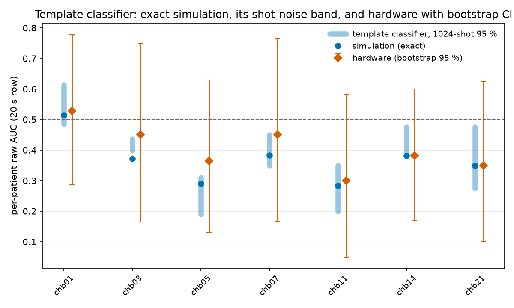

# PROMPT P2REV-03 - The quantum rows, 20 s only (revised Jobs 2-6)

**Generated:** 2026-10-31
**Script:** `scripts/p2rev03_quantum_gap.py` (jobs 0-1: 2026-10-25; revised jobs 2-6 under the
"Revision of scope after the Job 1 checkpoint")
**Depends on:** Job 0/1 outputs (`run_inventory.md`, `ideal_scores_20s.csv`,
`job1_reproduction.json`); P2REV-02 `geometric_sign.csv`, `per_patient_auc.csv`;
`submission/dqs_v1/main.tex` (Paper 1)

Conventions: the two **20 s rows only** - `quantum_20s_hardware.json` (per-window scores,
1024 shots, ibm_torino) and `quantum_20s_simulation.json` (exact statevector, reproduced to
0.0 in Job 1). The two "1.95 s" rows are **removed from the revision** (the window is 2.0 s in
the code, the rows used different estimators, the hardware row has no per-segment scores). The
classifier under test is the one the code ran: dual-template fidelity (per-fold templates from
training patients' averaged $(a,b,c)$; counts scored by Hellinger fidelity on hardware,
probability-Bhattacharyya in simulation). All AUCs raw; original labelling (the only one these
fixed segment sets have). Pre-declared: **H1, Q1, G2 (revised)**. Expectation block (Jim):
"nothing is correct and it's all noise" - H1 passes, Q1 fails, G2 at chance. An interim run
analysed the fixed ancilla observable instead; it is archived under `z0_analysis/` and is not
part of the revision.

---

## Job 2 - Paper 1 and the reproducibility statement

**Paper 1 describes the template classifier.** Abstract: "the quantum **fidelity classifier**
achieves 53.4\% AUC ... cross-subject **template mismatch**"; Limitations:
"\textbf{Template-based classification}: The quantum fidelity approach uses **fixed
templates** rather than learned decision boundaries"; Hellinger fidelity is defined for
hardware count distributions (l. 343). No ancilla readout, no $(N_0-N_1)/N$, appears anywhere.
The ancilla-expectation description is unique to Paper 2's section 3.5 and matches neither
Paper 1 nor the code. Caveats quoted in `paper1_description.md`: the SWAP-test framing of the
complexity section was never executed, and the templates are fixed only within a fold.

**Reproducibility (R2 section 1.9):** the classical implementation of the submitted classifier
*is* the statevector pipeline in the repository - `scripts/quantum_20s_simulation.py`
(parameter-averaged templates, `statevector_fidelity` scoring), re-executed end-to-end by
`scripts/p2rev03_quantum_gap.py` stage job1 with per-patient deviation **0.0** from the
submitted row. No IBM access is required to reproduce every simulated number in the revised
quantum section.

## Job 3 - H1 (revised): shot-noise interval of the template classifier

For each LOSO fold: exact probability distributions of both template circuits and every test
circuit; 1024-shot multinomial samples of all of them; Hellinger-on-counts scoring exactly as
`quantum_20s_hardware.py`; 200 seeds (`shot_distribution_20s.csv`). Template construction was
re-verified first: exact Bhattacharyya scores reproduce the submitted simulation row to
**0.0** in every fold.

| patient | shot 95 % | sim exact | hardware | percentile |
|---|---|---|---|---|
| chb01 | [0.486, 0.614] | 0.514 | 0.529 | 36 |
| chb03 | [0.400, 0.436] | 0.371 | 0.450 | **99** |
| chb05 | [0.190, 0.310] | 0.290 | 0.365 | **100** |
| chb07 | [0.350, 0.450] | 0.383 | 0.450 | 98.5 |
| chb11 | [0.200, 0.350] | 0.283 | 0.300 | 64.5 |
| chb14 | [0.381, 0.475] | 0.381 | 0.381 | 5 |
| chb21 | [0.275, 0.475] | 0.350 | 0.350 | 31 |
| overall (mean) | [0.361, 0.412] | 0.368 | 0.404 | 93 |
| overall (pooled) | [0.367, 0.407] | 0.389 | 0.389 | **50** |

**Verdict: H1 (revised) PASS** - 5/7 patients inside; the pooled hardware AUC sits at the
**50th percentile** of the simulated classifier's own shot distribution. Per the
pre-declaration, the manuscript's simulation-hardware section is replaced by one sentence
giving the percentile. The two patients outside (chb03, chb05) have hardware *above* the band
- the direction the submitted section read as "hardware outperforms simulation" - by 0.014
and 0.055 of AUC on 24- and 20-window test sets whose bootstrap CIs span ~0.5 of AUC.

## Job 4 - Q1 (revised): permutation and bootstrap on the 20 s rows

`per_patient_20s.csv`: every hardware per-patient bootstrap CI straddles 0.5 (e.g. chb11
[0.05, 0.58]; chb01 [0.29, 0.78]); permutation finds **zero** of 7 patients below chance at
$p < 0.05$ on the hardware row (and zero on the exact simulation row). Tier 3's below-chance
set (P2REV-02) is {chb06, chb08} - neither is in the hardware subset. Both labellings are not
available for these rows; the segments are fixed by the hardware run.

**Verdict: Q1 (revised) FAIL (0 of the required >= 3)** - as pre-declared, the section-5.2
sentence that sub-chance AUC is an explicit polarity readout is **removed**.

## Job 5 - G2 (revised): the sign table

`sign_table_20s.csv` (7 patients; $\pi_p$ and cosine from P2REV-02, original labelling; signs
with bootstrap CIs; supplementary $\langle Z_0\rangle$ column labelled as the fixed observable
described in submitted section 3.5, not what produced any reported number):

| pair | agree |
|---|---|
| $\pi_p$ vs Tier 3 | 5/7 |
| $\pi_p$ vs **sim 20 s** | **4/7** |
| $\pi_p$ vs hw 20 s | 4/7 |
| **hw 20 s vs sim 20 s** | **7/7** |
| Tier 3 vs hw 20 s | 2/7 |
| Tier 3 vs sim 20 s | 2/7 |

**Verdict: G2 (revised) FAIL** - 4/7, within the expectation block's "around 3-4 of 7". The
7/7 hardware-simulation agreement is the sign-level restatement of H1: the hardware run is the
simulated classifier plus shot noise. That classifier's signs track Tier 3 at 2/7 - the
template scores and the Riemannian scores do not measure the same per-patient orientation.

## Reading

Jim's expectation block is confirmed on all three blocks. The simulation-hardware
"divergence" of the submitted manuscript does not survive its own shot noise: the pooled
hardware AUC is the median of the simulated classifier's 1024-shot distribution, 5/7 patients
sit inside their bands, and the two exceptions are small exceedances on wide CIs in the
direction the manuscript had read as a hardware advantage. Nothing in the 20 s rows is
individually below chance, so the explicit-polarity-readout argument has no surviving
instance. The sign structure that remains - hardware and simulation agreeing 7/7 with each
other while agreeing with Tier 3 on 2/7 - says the quantum rows measured a consistent
quantity, just not the one the geometric story is about. $\pi_p$ (P2REV-02 G1) remains the
only quantity in the family with pre-declared predictive behaviour.

## Job 6 - What changes in the manuscript (quantum part)

Against the submitted text:

- **Section 3.5, scoring rule** - "The raw classification score for each window was computed
  from the Z-basis expectation value ... $(N_0 - N_1)/N$" and "Polarity calibration was
  applied identically": **replaced** by the executed rule: dual-template fidelity
  classification; per-fold templates from the 21 (hardware: 6) training patients' averaged
  PLV parameters; hardware scores = Hellinger fidelity between measured 17-qubit count
  distributions and the two template circuits' distributions; simulation scores = the same
  with exact probabilities. "No trained parameters" and "fixed measurement basis" claims are
  withdrawn (the templates are a trained component); Paper 1's own description ("quantum
  fidelity classifier", "fixed templates") is the citable precedent.
- **Section 3.5, encoding details** - "1.95-second" becomes 2.0 s wherever it survives (it
  does not: the 1.95 s rows are removed); the quantum pipeline's lack of the classical
  preprocessing chain (0.5-40 Hz, notch, z-score) is stated; the circuit is the open-chain
  variant (`QA1/multichannel_circuit.py`).
- **Section 4.2 (quantum window comparison), section 4.4 and section 5.3, and
  $\Delta = 0.0515$** - **removed**: both 1.95 s rows leave the revision, and the 20 s
  simulation-hardware comparison is replaced by the single pre-declared sentence: the pooled
  hardware AUC sits at the 50th percentile of the simulated template classifier's 1024-shot
  distribution (5/7 patients inside their 95 % bands; per-patient values with intervals in
  the table).
- **Table 1 quantum rows** - the two 1.95 s rows are removed; the two 20 s rows are restated
  with their bootstrap CIs (`per_patient_20s.csv`) and the shot-noise percentile column.
- **Table 4, QSim column and section 4.3 concordance text** - the 1.95 s simulation column is
  removed with its row; the 20 s sign table (`sign_table_20s.csv`) replaces it, with CIs and
  the 7/7 hw-sim / 2/7 vs-Tier-3 agreement stated.
- **Section 5.2** - the sub-chance-readout argument is removed (Q1); the diagnostic-instrument
  framing is reduced to what the data support: the hardware run reproduces the simulated
  template classifier to within shot noise.
- **`docs/AGATE_OBSERVABLE_NOTES.md` section 0** - one-line correction: its "what the circuit
  measures today" described the default ancilla readout of `qdnu/multichannel_circuit.py`, a
  module (and readout) the Paper 1/2 runs did not use; the executed runs measured all qubits
  and classified by template fidelity.

No mechanism is proposed for any gap.
