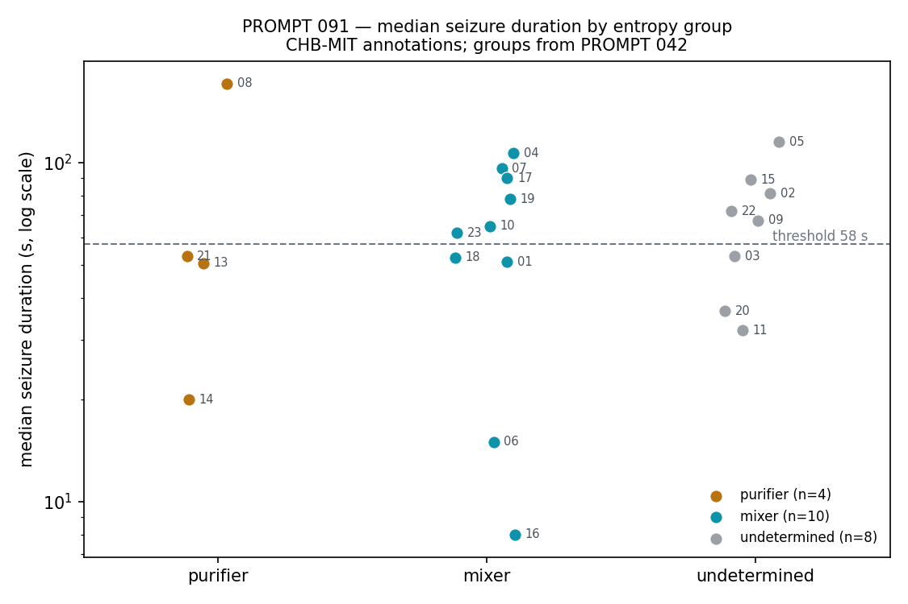

# PROMPT 091 - Seizure duration by entropy group

**Generated:** 2026-10-11
**Script:** `scripts/prompt091_duration_by_group.py`
**Depends on:** `results/prompt042/per_patient.csv` (the groups)

Conventions: CHB-MIT **annotation files only** (`chbXX-summary.txt`), 22 patients (chb12 and chb24 excluded, as in 037-042). One row per annotated seizure; duration = `Seizure End Time` minus `Seizure Start Time`, in seconds. No EEG is read in this prompt, no covariance is formed and **no entropy is computed** - the purifier / mixer / undetermined split is taken as given from 042 (sign of the ictal entropy change $\Delta S = \operatorname{median}_{\text{ictal}} S - \operatorname{median}_{\text{interictal}} S$, determined when Mann-Whitney $p < 0.05$ and bootstrap stability $\geq 0.9$). Pre-declared: **P1** purifier median durations exceed mixer median durations (Mann-Whitney one-sided, $p < 0.05$); **flip rate** against a threshold equal to the median of the 14 determined patients' median durations.

---

## The two readings being separated

| reading | claim about the 042 split | duration prediction |
|---|---|---|
| A - two regimes | purifiers and mixers are different dynamics | duration should not matter |
| B - one regime, two clocks | one rise-peak-fall entropy curve; purifiers are the patients whose seizures run past the peak | duration should separate the groups |

## Results (142 seizures, 22 patients)

| patient | group | n | min (s) | median (s) | max (s) | max/min |
|---|---|---|---|---|---|---|
| chb08 | purifier | 5 | 134 | 171.0 | 264 | 1.97 |
| chb13 | purifier | 12 | 17 | 50.5 | 70 | 4.12 |
| chb14 | purifier | 8 | 14 | 20.0 | 41 | 2.93 |
| chb21 | purifier | 4 | 12 | 53.0 | 81 | 6.75 |
| chb01 | mixer | 7 | 27 | 51.0 | 101 | 3.74 |
| chb04 | mixer | 4 | 49 | 106.5 | 116 | 2.37 |
| chb06 | mixer | 10 | 12 | 15.0 | 20 | 1.67 |
| chb07 | mixer | 3 | 86 | 96.0 | 143 | 1.66 |
| chb10 | mixer | 7 | 35 | 65.0 | 89 | 2.54 |
| chb16 | mixer | 10 | 6 | 8.0 | 14 | 2.33 |
| chb17 | mixer | 3 | 88 | 90.0 | 115 | 1.31 |
| chb18 | mixer | 6 | 30 | 52.5 | 68 | 2.27 |
| chb19 | mixer | 3 | 77 | 78.0 | 81 | 1.05 |
| chb23 | mixer | 7 | 20 | 62.0 | 113 | 5.65 |
| chb02 | undetermined | 3 | 9 | 81.0 | 82 | 9.11 |
| chb03 | undetermined | 7 | 47 | 53.0 | 69 | 1.47 |
| chb05 | undetermined | 5 | 96 | 115.0 | 120 | 1.25 |
| chb09 | undetermined | 4 | 62 | 67.5 | 79 | 1.27 |
| chb11 | undetermined | 3 | 22 | 32.0 | 752 | 34.18 |
| chb15 | undetermined | 20 | 31 | 89.0 | 205 | 6.61 |
| chb20 | undetermined | 8 | 29 | 36.5 | 49 | 1.69 |
| chb22 | undetermined | 3 | 58 | 72.0 | 74 | 1.28 |

### P1 - duration by group

| | purifiers (n=4) | mixers (n=10) |
|---|---|---|
| median of per-patient medians | 51.8 s | 63.5 s |
| per-patient medians | 20, 50.5, 53, 171 | 8, 15, 51, 52.5, 62, 65, 78, 90, 96, 106.5 |

Mann-Whitney U = 18.0, one-sided $p = 0.6334$, rank-biserial $r = -0.10$.

### Flip rate

Threshold = median of the 14 determined patients' medians = **57.5 s**. Flips = **9/14 = 64%**.

| patient | group | median (s) | why it is a flip |
|---|---|---|---|
| chb13 | purifier | 50.5 | purifier below threshold |
| chb14 | purifier | 20.0 | purifier below threshold |
| chb21 | purifier | 53.0 | purifier below threshold |
| chb04 | mixer | 106.5 | mixer above threshold |
| chb07 | mixer | 96.0 | mixer above threshold |
| chb10 | mixer | 65.0 | mixer above threshold |
| chb17 | mixer | 90.0 | mixer above threshold |
| chb19 | mixer | 78.0 | mixer above threshold |
| chb23 | mixer | 62.0 | mixer above threshold |

### Within-patient spread

4 of the 14 determined patients have max/min duration > 3: chb13, chb21, chb01, chb23.

## Reading

The two groups' durations are not distinguishable, and what ordering there is runs the wrong way for B: the purifier median-of-medians is 51.8 s against the mixers' 63.5 s, one-sided $p = 0.6334$ (rank-biserial $-0.10$). The distributions sit on top of each other - purifier medians span 20-171 s, mixer medians 8-106.5 s - and only chb08 at 171 s is longer than every mixer. The other three purifiers are mid-pack or short: chb14 at 20 s is shorter than seven of the ten mixers.

The flip rate needs its floor stated before it means anything. With 4 purifiers among 14 determined patients and a median-split threshold, exactly 7 medians sit above the line, so the flip count is $11 - 2a$ for $a$ purifiers above it and can only take the values 3, 5, 7, 9, 11. **It cannot reach zero.** Floor 3/14 (21%, perfect-B ordering); chance expectation 7/14 (50%); ceiling 11/14. The observed 9/14 (64%) is one step *worse* than chance rather than between zero and chance, and is not a reversed effect either: $P(\text{flips} \geq 9) = 0.28$. It is noise.

The within-patient spread cuts the same way. B needs a patient's seizures to be consistently long or consistently short for the 042 sign to come out stable, yet 4 of the 14 determined patients vary by more than 3x within themselves (chb13 4.1x, chb21 6.8x, chb01 3.7x, chb23 5.7x), including two of the four purifiers - chb21 ranges 12-81 s and chb13 17-70 s. Under B those patients should straddle the entropy peak and give an unstable sign; 042 found their signs stable at bootstrap 0.9 or better.

## Verdict

**P1 FAIL** (one-sided $p = 0.6334$, $\alpha = 0.05$; the point estimate runs the other way). Flip rate 64%, against a metric floor of 21% and a chance expectation of 50%.

## Consequences

Reading B - one regime, two clocks, purifiers being the patients whose seizures run past the entropy peak - makes a prediction this cohort does not show. Duration does not separate the groups, the ordering that exists is the wrong way round, and patients whose own seizures vary several-fold in length still carry a stable entropy sign. That is three strikes against the simplest form of B. It is not a proof of A: median duration is a crude stand-in for time spent past the peak, a seizure's annotated end is not the end of its entropy excursion, and 14 patients is a small cohort. But B no longer gets to be the default reading, and nothing here requires A either.

For Notebook 03 the consequence is concrete: the within-seizure curve has to be measured, not inferred from how long seizures last. The design does not change - time-resolved $S(\rho)$ from onset, per seizure, on the 037 per-seizure structure - but the question it asks does. It is no longer “do purifiers simply run longer”; it is whether a rise-peak-fall shape exists in any patient at all, and if it does, whether where a patient stops on that curve tracks the 042 sign. If the curves come back with no common shape, A and B are both wrong and the split is something else. This check cost nothing and removed one of the two readings as a default; that is what it was for.

*Annotation data only: this prompt read CHB-MIT summary files, computed no entropy and opened no EEG.*
