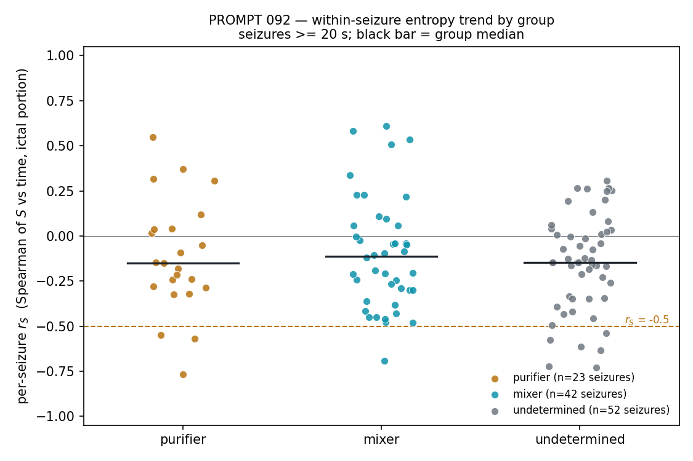

# PROMPT 092 - Within-seizure time-resolved entropy

**Generated:** 2026-10-12
**Script:** `scripts/prompt092_within_seizure_entropy.py`
**Depends on:** 037 (segment building), 042 (groups), 091 (reading B dropped)

**Stance, on record (2026-10-11): no expectation.** The within-seizure entropy path had never been measured; this is the first measurement. Reading A was pre-declared because it was the only live reading, not because it was expected to hold.

Conventions: 22 patients, CH8 montage, 256 Hz, `preprocess_eeg` (demean, 0.5-128 Hz bandpass, 60 Hz notch) and `build_segments` reused from 037 verbatim; `Covariances(estimator='lwf')`. Sliding window 2 s at 1 s step from 20 s before onset to the annotated offset; window centre time is relative to onset. Per window $\rho = \Sigma/\operatorname{tr}\Sigma$ and $S = -\sum_k \lambda_k \ln \lambda_k$ over the 8 eigenvalues of $\rho$, plus $\log\operatorname{tr}\Sigma$. Ictal portion = window centres $\geq 0$; $S_0$ = mean $S$ over the 5 s before onset. Seizures shorter than 20 s are computed and plotted but excluded from every statistic.

---

## Counts

| group | seizures | $\geq$ 20 s (used) | < 20 s (excluded) |
|---|---|---|---|
| purifier | 29 | 23 | 6 |
| mixer | 60 | 42 | 18 |
| undetermined | 53 | 52 | 1 |
| **all** | **142** | **117** | **25** |

## Verdict

**P1 FAIL** - purifier seizures (n = 23), both clauses required:

- $r_S \leq -0.5$ in 13%, needed $\geq$ 75% - **not met**
- interior-peak false in 30%, needed $\geq$ 75% - **not met**

**P2 FAIL** - mixer seizures (n = 42), both clauses required:

- median $|r_S| = 0.235$, needed $< 0.5$ - met
- groups differ on $r_S$: Mann-Whitney $p = 0.9617$, needed $< 0.05$ - **not met**

**Reading A FAILS** (A fails if either P1 or P2 fails).

## Reading - the shapes seen

**purifier** (23 seizures $\geq$ 20 s): 3 fall ($r_S \leq -0.5$), 1 rise ($r_S \geq +0.5$), 19 wobble (|$r_S$| < 0.5); median $r_S = -0.15$. Interior peak in 16/23. Median turning points 14; median time of the entropy maximum at 0.05 of seizure length; median $S_{\text{offset}} - S_0 = -0.402$ nats. Median Spearman($S$, $\log\operatorname{tr}\Sigma$) within seizure = -0.45.

Per-patient median $r_S$: chb08 -0.28 (n=5), chb13 -0.12 (n=10), chb14 -0.21 (n=5), chb21 +0.12 (n=3).

**mixer** (42 seizures $\geq$ 20 s): 1 fall ($r_S \leq -0.5$), 4 rise ($r_S \geq +0.5$), 37 wobble (|$r_S$| < 0.5); median $r_S = -0.11$. Interior peak in 41/42. Median turning points 18; median time of the entropy maximum at 0.39 of seizure length; median $S_{\text{offset}} - S_0 = +0.023$ nats. Median Spearman($S$, $\log\operatorname{tr}\Sigma$) within seizure = -0.41.

Per-patient median $r_S$: chb01 -0.09 (n=7), chb04 +0.56 (n=4), chb06 +0.28 (n=2), chb07 -0.30 (n=3), chb10 -0.21 (n=7), chb17 -0.21 (n=3), chb18 -0.27 (n=6), chb19 -0.19 (n=3), chb23 -0.04 (n=7).

**undetermined** (52 seizures $\geq$ 20 s): 6 fall ($r_S \leq -0.5$), 0 rise ($r_S \geq +0.5$), 46 wobble (|$r_S$| < 0.5); median $r_S = -0.15$. Interior peak in 47/52. Median turning points 16; median time of the entropy maximum at 0.36 of seizure length; median $S_{\text{offset}} - S_0 = -0.016$ nats. Median Spearman($S$, $\log\operatorname{tr}\Sigma$) within seizure = -0.54.

Per-patient median $r_S$: chb02 +0.05 (n=2), chb03 -0.16 (n=7), chb05 -0.16 (n=5), chb09 -0.24 (n=4), chb11 -0.12 (n=3), chb15 -0.05 (n=20), chb20 -0.18 (n=8), chb22 +0.02 (n=3).

### Is entropy just tracking power?

Within-seizure Spearman of $S$ against $\log\operatorname{tr}\Sigma$: median -0.45 over 117 seizures, |value| > 0.9 in 3/117. The two are not interchangeable: the state carries something the trace does not.

### Consistency with 042

The endpoint reproduces the 042 split even though the path does not separate: median $S_{\text{offset}} - S_0$ is -0.402 nats for purifier seizures against +0.023 for mixers. 042 classified patients on medians over whole ictal and interictal windows; this measurement, on 2 s windows inside the seizure, puts the two groups on the same side of zero that 042 did. The null here is about the shape of the path, not about whether the 042 endpoint is real.

### Shapes by patient, where they are clearest

- **chb14** (purifier, 5 seizures $\geq$ 20 s): the entropy leaves baseline downward immediately - median time of the maximum at 0.05 of seizure length, median $S_{\text{offset}} - S_0 = -0.455$ nats, and 7 of its 8 seizures (including the three under 20 s) end below baseline. Its median of 5 turning points is the lowest in the cohort: these are the least wobbly curves measured.
- **chb08** (purifier, 5 seizures, the longest in the cohort at 134-264 s): $S$ wobbles through a band of roughly 0.8-1.8 nats with a median of 47 turning points per seizure, with a slow net decline ($r_S$ median -0.28).
- **chb04** (mixer, 4 seizures): the only patient with a median $r_S \geq +0.5$ (+0.56), entropy maximum late at 0.83 of seizure length.
- **chb16** (mixer, 10 seizures): every seizure is under 20 s, so the patient contributes nothing to either test; its curves are plotted.

### Not pre-declared, for a future prompt

The reproducible within-seizure structure in these curves sits in $\log\operatorname{tr}\Sigma$ rather than in $S$, and where $S$ does move consistently (chb14: 7 of 8 seizures end below baseline, median $S_{\text{offset}} - S_0 = -0.46$ nats) the move happens within the first seconds after onset rather than spread across the seizure.

Per-patient curve figures are in `curves/chbXX.png` (22 files), each showing every seizure's $S(t)$ with $\log\operatorname{tr}\Sigma(t)$ below on the same time axis, onset at $t = 0$ and the 5 s baseline band shaded. No smoothing is applied to the plotted curves.

Runtime 11 s.
